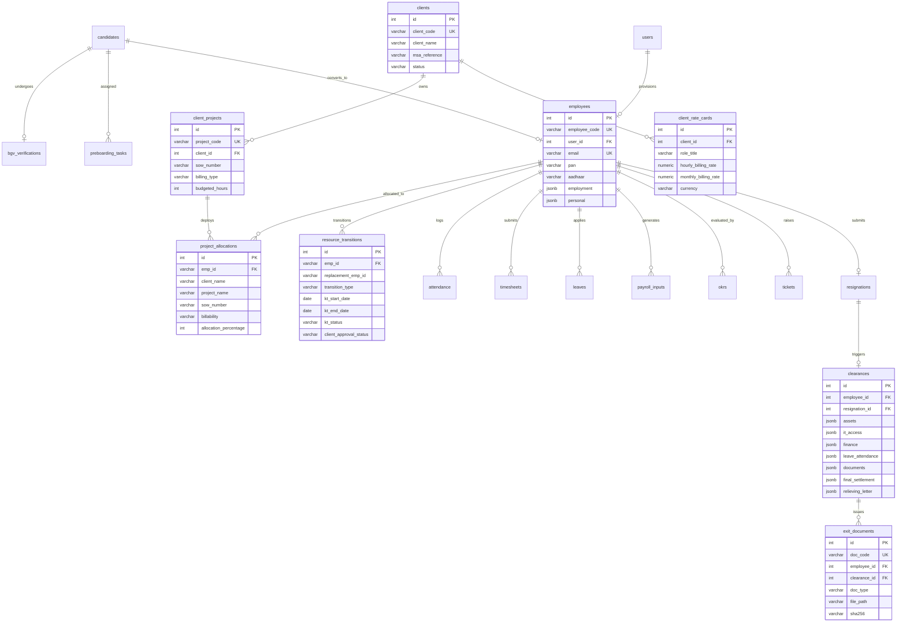
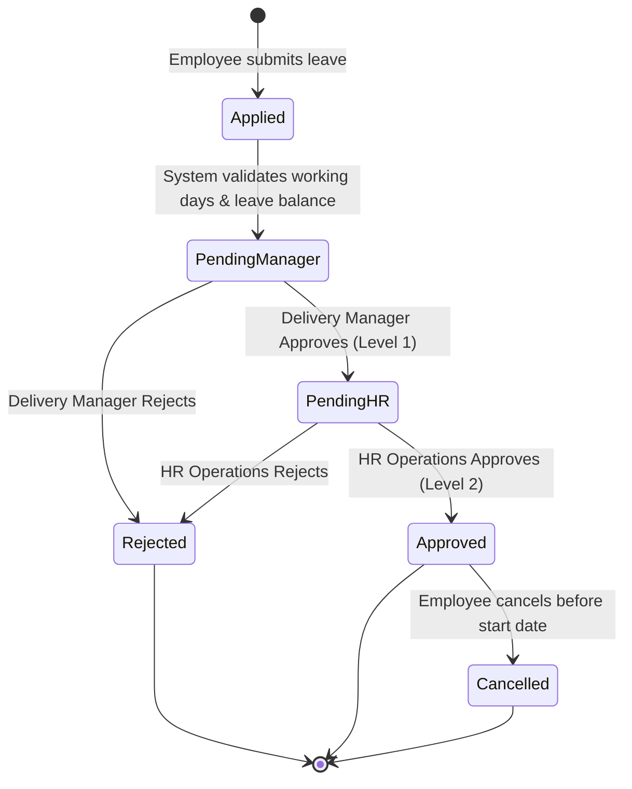
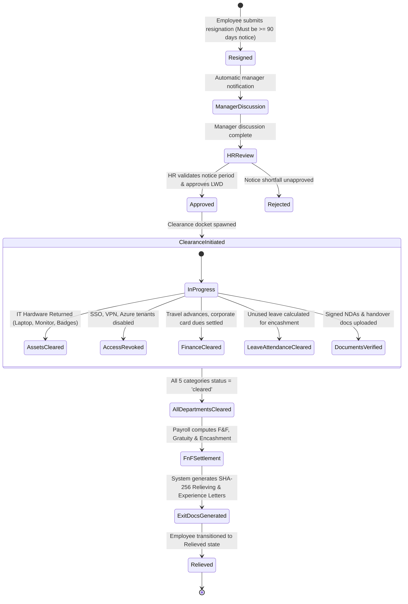

# Quadratic Systems Inc. — PERN HRMS
## Comprehensive Development Team Deliverables (Staff-Augmentation Enterprise Edition)

**System Version**: 2.6.0-ENTERPRISE  
**Architecture**: PERN Stack (PostgreSQL 16, Express 5, React 18, Node.js 24)  
**Execution Environment**: Ports: Backend `5005`, Frontend `5173`  
**Compliance Standard**: SOC-2 Type II, ISO 27001, Indian Statutory Compliance (PF, ESI, PT, TDS), GDPR  

---

# Table of Contents
1. [Functional Requirements Document (FRD) with Field-Level Specifications](#1-functional-requirements-document-frd-with-field-level-specifications)
2. [Database Schema and Mermaid ER Diagram](#2-database-schema-and-mermaid-er-diagram)
3. [REST API Specification (OpenAPI Standard)](#3-rest-api-specification-openapi-standard)
4. [Screen Wireframes and Role Navigation Map](#4-screen-wireframes-and-role-navigation-map)
5. [Role-Based Access Control (RBAC) Permission Matrix](#5-role-based-access-control-rbac-permission-matrix)
6. [Approval Workflow Configuration & State Machines](#6-approval-workflow-configuration--state-machines)
7. [Integration Specifications (Payroll, Attendance & BGV)](#7-integration-specifications-payroll-attendance--bgv)
8. [Data Migration Template & Field Mapping Engine](#8-data-migration-template--field-mapping-engine)
9. [Test / UAT Pack & Verification Scripts](#9-test--uat-pack--verification-scripts)
10. [Production Support and Disaster Recovery (DR) Runbook](#10-production-support-and-disaster-recovery-dr-runbook)

---

# 1. Functional Requirements Document (FRD) with Field-Level Specifications

## 1.1 Executive Summary
The Staff-Augmentation HRMS is engineered to govern the complete 16-stage **Hire-to-Retire Lifecycle** with purpose-built data models for client engagements, Statement of Work (SOW) management, deployment billability, resource transitions, and commercial rate card masking.

```
┌─────────────────────────────────────────────────────────────────────────────────────────────────────────────────────────────────────────────────┐
│                                                   16-STAGE HIRE-TO-RETIRE WORKFLOW PIPELINE                                                     │
└─────────────────────────────────────────────────────────────────────────────────────────────────────────────────────────────────────────────────┘
 [01. Recruitment] ──> [02. Offer] ──> [03. BGV] ──> [04. Preboarding] ──> [05. Onboarding] ──> [06. Employee Master]
                                                                                                        │
 ┌──────────────────────────────────────────────────────────────────────────────────────────────────────┘
 │
 ├──> [07. Client/Project Deployment] (SOW, Billability: Billable/Shadow/Bench, Commercial Masking)
 ├──> [08. Attendance/Timesheet] (Biometric Punches + Billable Hours Log)
 ├──> [09. Leave] (2-Level Approval: Delivery Manager -> HR Operations)
 ├──> [10. Payroll Inputs] (Gross-to-Net, LOP, PF, Professional Tax)
 ├──> [11. Helpdesk] (Ticket SLA Escalation Matrix)
 ├──> [12. Performance] (SOW Milestone OKRs & Quarterly Review)
 ├──> [13. Resignation] (Strict 90-Day Notice Period Enforcement)
 ├──> [14. Clearance Docket] (5-Department Zero-Dues: Assets, IT Access, Finance, Leave, HR Docs)
 ├──> [15. F&F Inputs] (Settlement Reconciliation, Leave Encashment, Gratuity)
 └──> [16. Exit Documents] (Cryptographic Relieving Letter, Experience Cert, F&F Statement with SHA-256)
```

---

## 1.2 Field-Level Specifications by Lifecycle Stage

### Stage 01: Recruitment & Sourcing (`candidates`)
| Field Name | Target Column | Data Type | Mandatory | Validation Rules & Regex | Default Value | Description |
| :--- | :--- | :--- | :---: | :--- | :--- | :--- |
| `candidateId` | `candidate_id` | `VARCHAR(50)` | Yes | Unique, format: `^CAND-\d{3,}$` | Auto-generated | Unique ATS candidate tracking identifier |
| `name` | `name` | `VARCHAR(150)` | Yes | Min 2 chars, letters and spaces | None | Full legal candidate name |
| `email` | `email` | `VARCHAR(150)` | Yes | Valid RFC 5322 email regex | None | Primary candidate correspondence email |
| `phone` | `phone` | `VARCHAR(30)` | No | E.164 format: `^\+?[1-9]\d{7,14}$` | `""` | Mobile telephone number |
| `role` | `role` | `VARCHAR(100)` | Yes | Must match designated capability | `"Architect"` | Profile or skills designation applied for |
| `department` | `department` | `VARCHAR(100)` | Yes | Predefined org departments | `"Engineering"` | Candidate organizational unit |
| `source` | `source` | `VARCHAR(50)` | No | `Naukri`, `LinkedIn`, `Referral`, `Agency` | `"Direct"` | Candidate sourcing channel |
| `status` | `status` | `VARCHAR(30)` | Yes | `Applied`, `Screening`, `Interviewing`, `Selected`, `Rejected`, `Hired` | `"Applied"` | ATS pipeline progress status |

### Stage 02: Offer Generation (`candidates`)
| Field Name | Target Column | Data Type | Mandatory | Validation Rules & Regex | Default Value | Description |
| :--- | :--- | :--- | :---: | :--- | :--- | :--- |
| `stage` | `stage` | `VARCHAR(50)` | Yes | `Offered`, `Accepted`, `Declined` | `"Offered"` | Offer negotiation state |
| `offeredCtc` | `salary` / `offered_ctc` | `NUMERIC(14,2)` | Yes | Positive value $\ge 100,000$ | `0.00` | Annual Cost to Company (CTC) in INR |
| `tentativeDoj` | `tentative_doj` | `DATE` | Yes | Future date: `YYYY-MM-DD` | None | Agreed tentative date of joining |

### Stage 03: Background Verification (`bgv_verifications`)
| Field Name | Target Column | Data Type | Mandatory | Validation Rules & Regex | Default Value | Description |
| :--- | :--- | :--- | :---: | :--- | :--- | :--- |
| `bgvCode` | `bgv_code` | `VARCHAR(50)` | Yes | Unique, `^BGV-CAND-\d+$` | Auto-generated | BGV case file reference code |
| `candidateId` | `candidate_id` | `VARCHAR(50)` | Yes | Foreign Key -> `candidates.candidate_id` | None | Linked candidate reference |
| `verificationType`| `verification_type`| `VARCHAR(50)` | Yes | `Education`, `Criminal`, `Employment`, `Comprehensive` | `"Comprehensive"` | Verification check category |
| `agency` | `agency` | `VARCHAR(100)` | Yes | Approved screening vendor | `"First Advantage"`| External verification agency |
| `status` | `status` | `VARCHAR(30)` | Yes | `Initiated`, `In Progress`, `Verified`, `Discrepancy` | `"Initiated"` | Current verification status |
| `result` | `result` | `VARCHAR(50)` | Yes | `Clear`, `Amber`, `Red`, `Pending` | `"Pending"` | Screening risk score outcome |
| `discrepancyNotes`| `discrepancy_notes`| `TEXT` | No | Free-form explanation if Amber/Red | `""` | Findings and discrepancies audit log |

### Stage 04 & 05: Preboarding & Onboarding Gate (`preboarding_tasks`)
| Field Name | Target Column | Data Type | Mandatory | Validation Rules & Regex | Default Value | Description |
| :--- | :--- | :--- | :---: | :--- | :--- | :--- |
| `candidateId` | `candidate_id` | `VARCHAR(50)` | Yes | Foreign Key -> `candidates.candidate_id` | None | Linked candidate identifier |
| `taskName` | `task_name` | `VARCHAR(150)` | Yes | Min 3 chars | None | Provisioning item (Laptop, VPN, ID badge) |
| `category` | `category` | `VARCHAR(50)` | Yes | `IT_PROVISIONING`, `HR_DOCS`, `FACILITIES` | None | Task operational division |
| `status` | `status` | `VARCHAR(30)` | Yes | `Pending`, `In Progress`, `Completed`, `Waived` | `"Pending"` | Gate conversion blocker status |
| `slaDueDate` | `sla_due_date` | `TIMESTAMP` | Yes | Valid date $\le$ Date of Joining | None | Service level delivery deadline |

### Stage 06: Employee Master (`employees`)
| Field Name | Target Column | Data Type | Mandatory | Validation Rules & Regex | Default Value | Description |
| :--- | :--- | :--- | :---: | :--- | :--- | :--- |
| `employeeCode`| `employee_code`| `VARCHAR(50)` | Yes | Unique, format: `^EMP-\d{3,}$` | Auto-seq | Official enterprise employee identifier |
| `userId` | `user_id` | `INTEGER` | Yes | Foreign Key -> `users.id` | None | Linked system access user record |
| `firstName` | `first_name` | `VARCHAR(100)` | Yes | Alphabetic characters only | None | Employee primary name |
| `lastName` | `last_name` | `VARCHAR(100)` | No | Alphabetic characters | `""` | Employee family surname |
| `email` | `email` | `VARCHAR(150)` | Yes | Valid corporate email address | None | Work email for authentication & SSO |
| `pan` | `pan` | `VARCHAR(20)` | Yes | Regex: `^[A-Z]{5}[0-9]{4}[A-Z]{1}$` | None | Indian Income Tax PAN identifier |
| `aadhaar` | `aadhaar` | `VARCHAR(20)` | Yes | Regex: `^\d{4}\s?\d{4}\s?\d{4}$` | None | Indian UIDAI Aadhaar 12-digit number |
| `employment` | `employment` | `JSONB` | Yes | Valid JSON object with status, salary | `{}` | Designation, department, joining date |
| `personal` | `personal` | `JSONB` | Yes | Valid JSON object | `{}` | Blood group, emergency contact, skills |

### Stage 07: Staff Augmentation Client, SOW & Deployment

#### Client Master (`clients`)
| Field Name | Target Column | Data Type | Mandatory | Validation Rules | Default Value | Description |
| :--- | :--- | :--- | :---: | :--- | :--- | :--- |
| `clientCode` | `client_code` | `VARCHAR(50)` | Yes | Unique, uppercase, `^CLT-[A-Z0-9]+$` | None | Unique enterprise client account code |
| `clientName` | `client_name` | `VARCHAR(200)` | Yes | Corporate entity legal name | None | Client registered company name |
| `msaReference`| `msa_reference`| `VARCHAR(100)` | Yes | Master Service Agreement contract ref | None | Legal umbrella MSA identifier |
| `accountOwner`| `account_owner`| `VARCHAR(100)` | No | Client Partner / VP Delivery | `"Executive"` | Internal client relationship executive |
| `status` | `status` | `VARCHAR(30)` | Yes | `Active`, `Inactive`, `Terminated` | `"Active"` | Client operational status |

#### Client Projects & SOWs (`client_projects`)
| Field Name | Target Column | Data Type | Mandatory | Validation Rules | Default Value | Description |
| :--- | :--- | :--- | :---: | :--- | :--- | :--- |
| `projectCode` | `project_code` | `VARCHAR(50)` | Yes | Unique, uppercase, `^PRJ-[A-Z0-9]+$` | None | SOW engagement code |
| `clientId` | `client_id` | `INTEGER` | Yes | Foreign Key -> `clients.id` | None | Parent enterprise client |
| `sowNumber` | `sow_number` | `VARCHAR(100)` | Yes | Contractual SOW number | None | Legal Statement of Work document number |
| `billingType` | `billing_type` | `VARCHAR(50)` | Yes | `T&M`, `Fixed Price`, `Milestone` | `"T&M"` | Revenue model classification |
| `budgetedHours`| `budgeted_hours`| `INTEGER` | Yes | Non-negative integer | `0` | SOW contracted engineering hour cap |

#### Commercial Rate Cards (`client_rate_cards`) — 🔒 RBAC Guarded
| Field Name | Target Column | Data Type | Mandatory | Visibility Rule | Default Value | Description |
| :--- | :--- | :--- | :---: | :--- | :--- | :--- |
| `roleTitle` | `role_title` | `VARCHAR(100)` | Yes | All Roles | None | Staff role title (e.g. Lead Architect) |
| `skillset` | `skillset` | `VARCHAR(200)` | Yes | All Roles | None | Key required technical skills |
| `hourlyRate` | `hourly_billing_rate`| `NUMERIC(10,2)`| Yes | **Masked (`••••••`)** for non-privileged | None | Billed hourly rate to client |
| `monthlyRate`| `monthly_billing_rate`| `NUMERIC(12,2)`| Yes | **Masked (`••••••`)** for non-privileged | None | Billed monthly rate per engineer |
| `currency` | `currency` | `VARCHAR(10)` | Yes | All Roles | `"INR"` | Contract billing currency (INR, USD, EUR) |

#### Deployment & Allocation (`project_allocations`)
| Field Name | Target Column | Data Type | Mandatory | Validation Rules | Default Value | Description |
| :--- | :--- | :--- | :---: | :--- | :--- | :--- |
| `empId` | `emp_id` | `VARCHAR(50)` | Yes | Foreign Key -> `employees.id` | None | Deployed consultant employee ID |
| `projectName` | `project_name` | `VARCHAR(150)` | Yes | Linked client project | None | Active engagement name |
| `sowNumber` | `sow_number` | `VARCHAR(100)` | Yes | Must match active project SOW | None | SOW reference for client invoicing |
| `billability` | `billability` | `VARCHAR(30)` | Yes | `Billable`, `Shadow`, `Bench` | `"Billable"` | Utilization & billability classification |
| `allocationPercentage`| `allocation_percentage`| `INTEGER` | Yes | Min 10, Max 100 | `100` | Full-time equivalent (FTE) % |
| `startDate` | `start_date` | `DATE` | Yes | Valid date format | None | Deployment kick-off date |
| `endDate` | `end_date` | `DATE` | No | Must be $\ge$ `start_date` | None | Planned roll-off date |

#### Resource Transitions & Replacements (`resource_transitions`)
| Field Name | Target Column | Data Type | Mandatory | Validation Rules | Default Value | Description |
| :--- | :--- | :--- | :---: | :--- | :--- | :--- |
| `empId` | `emp_id` | `VARCHAR(50)` | Yes | Rolling-off consultant employee ID | None | Primary resource rolling off engagement |
| `replacementEmpId`| `replacement_emp_id`| `VARCHAR(50)` | No | Designated replacement resource | None | Incoming replacement consultant |
| `transitionType`| `transition_type`| `VARCHAR(50)` | Yes | `Roll-off`, `Replacement`, `Attrition` | `"Replacement"`| Transition trigger reason |
| `ktStartDate` | `kt_start_date` | `DATE` | Yes | Knowledge transfer commencement | None | Structured KT handover start |
| `ktEndDate` | `kt_end_date` | `DATE` | Yes | KT completion target date | None | Structured KT handover finish |
| `ktStatus` | `kt_status` | `VARCHAR(30)` | Yes | `Not Started`, `In Progress`, `Completed` | `"Not Started"` | Handover progress indicator |
| `clientApproval`| `client_approval_status`| `VARCHAR(30)` | Yes | `Pending`, `Approved`, `Rejected` | `"Pending"` | Client delivery manager sign-off |

---

# 2. Database Schema and Mermaid ER Diagram



---

# 3. REST API Specification (OpenAPI Standard)

All API endpoints are prefixed with `/api/v1` and protected with JWT Bearer Token validation in the `Authorization` header.

### 3.1 Authentication & Profile
| Endpoint | Method | Allowed Roles | Request Payload | Success Code | Description |
| :--- | :---: | :--- | :--- | :---: | :--- |
| `/auth/login` | `POST` | Public | `{ email, password }` | `200 OK` | Issues JWT with 8h expiry constraint |
| `/auth/me` | `GET` | Authenticated | None | `200 OK` | Retrieves current session user & employee |

### 3.2 Staff Augmentation & Client Governance
| Endpoint | Method | Allowed Roles | Request Payload | Success Code | Description |
| :--- | :---: | :--- | :--- | :---: | :--- |
| `/staff-aug/overview` | `GET` | All Roles | None | `200 OK` | Aggregate billability %, bench, SOW counts |
| `/staff-aug/pipeline/trace/:id` | `GET` | Admin, HR, Manager | None | `200 OK` | Audits 16-stage lifecycle for candidate/emp |
| `/client-master/clients` | `GET` | Admin, HR, Manager | None | `200 OK` | Lists enterprise client master records |
| `/client-master/clients` | `POST` | Admin, Super Admin | `{ clientCode, clientName, msaReference }` | `201 Created` | Creates new enterprise client account |
| `/client-master/projects` | `POST` | Admin, HR, Manager | `{ projectCode, clientId, sowNumber, billingType }` | `201 Created` | Registers client project & SOW |
| `/client-master/rate-cards` | `GET` | All Roles | None | `200 OK` | **Masked commercial rates for non-finance** |
| `/client-master/rate-cards` | `POST` | Admin, Finance | `{ roleTitle, skillset, hourlyRate, monthlyRate }` | `201 Created` | Creates commercial rate card |
| `/allocation` | `POST` | Admin, HR, Manager | `{ empId, clientName, sowNumber, billability }` | `201 Created` | Allocates engineer to client SOW |
| `/client-master/transitions` | `POST` | Admin, HR, Manager | `{ empId, replacementEmpId, ktStartDate, ktEndDate }` | `201 Created` | Schedules consultant roll-off / KT |

### 3.3 Core Lifecycle Ops (Stages 01 - 16)
| Endpoint | Method | Allowed Roles | Request Payload | Success Code | Description |
| :--- | :---: | :--- | :--- | :---: | :--- |
| `/candidates` | `POST` | HR, Recruiter, Admin | `{ name, email, phone, role, department }` | `201 Created` | Candidate sourcing & ATS registration |
| `/candidates/:id/bgv` | `PATCH` | HR, Admin | `{ bgv_status: "Verified", bgv_notes: "..." }` | `200 OK` | Updates BGV verification outcome |
| `/lifecycle-ops/preboarding/:id` | `POST` | HR, Admin | None | `201 Created` | Provisions 4-task IT/HR preboarding docket |
| `/lifecycle-ops/preboarding/tasks/:id` | `PATCH` | HR, Admin | `{ status: "Completed" }` | `200 OK` | Marks preboarding SLA task done |
| `/lifecycle-ops/onboarding/complete/:id` | `POST` | HR, Admin | `{ department, designation, salary }` | `200 OK` | **Guarded conversion gate to Master Record** |
| `/leaves` | `POST` | All Roles | `{ leaveTypeId, startDate, endDate, reason }` | `201 Created` | Submits leave request |
| `/leaves/:id/approve` | `PUT` | Manager, HR, Admin | `{ comments: "..." }` | `200 OK` | L1 / L2 leave decision sign-off |
| `/lifecycle-ops/payroll-inputs/generate` | `POST` | Payroll, Finance | `{ month: "YYYY-MM", employeeIds: [...] }` | `201 Created` | Computes gross-to-net payroll inputs |
| `/tickets` | `POST` | All Roles | `{ empId, query, priority, category }` | `201 Created` | Raises HR/IT helpdesk ticket |
| `/tickets/:id` | `PUT` | HR, Admin | `{ status: "Resolved", comment: "..." }` | `200 OK` | Resolves ticket within SLA window |
| `/performance` | `POST` | All Roles | `{ objective: "Deliver Client SOW..." }` | `201 Created` | Registers quarterly performance OKR |
| `/performance/:id/rate` | `PUT` | Manager, Admin | `{ score: 5, feedback: "..." }` | `200 OK` | Rates consultant delivery performance |
| `/resignations` | `POST` | Employee | `{ requestedLastWorkingDay, reasonCategory }` | `201 Created` | Enforces minimum 90-day notice period |
| `/resignations/:id/review` | `PATCH` | HR, Admin | `{ status: "approved", hrReviewComment: "..." }` | `200 OK` | Formal HR resignation acceptance |
| `/clearance/initiate` | `POST` | HR, Admin | `{ resignationId }` | `201 Created` | Initiates 5-department zero dues docket |
| `/clearance/:id/category/:cat` | `PATCH` | HR, Admin | `{ status: "cleared", comments: "..." }` | `200 OK` | Approves department clearance item |
| `/clearance/:id/settlement` | `PATCH` | Finance, Payroll | `{ details: "Net payable ₹2,27,400" }` | `200 OK` | Processes Full & Final (F&F) settlement |
| `/lifecycle-ops/exit-documents/generate`| `POST` | HR, Admin | `{ clearanceId }` | `201 Created` | **Generates SHA-256 Exit Certificates** |

---

# 4. Screen Wireframes and Role Navigation Map

## 4.1 Global Personas & Navigation Tree

```
  ┌────────────────────────────────────────────────────────────────────────────────────────┐
  │                                APPLICATION NAVIGATION TREE                             │
  └────────────────────────────────────────────────────────────────────────────────────────┘
  ├── [EMPLOYEE / CONSULTANT]
  │   ├── /employee/dashboard         -> My SOW Deployment, Punches, Leave Balances
  │   ├── /employee/attendance        -> Daily Punch Log & Regularization Requests
  │   ├── /employee/timesheets        -> Weekly Client SOW Hours Submission
  │   ├── /employee/leaves            -> Apply Leave & Status History
  │   ├── /employee/payroll           -> Monthly Payslips & Tax Declarations
  │   ├── /employee/documents         -> Vault & Download Signed Exit Letters
  │   ├── /employee/resignation       -> 90-day Notice Resignation & Clearance Tracker
  │   └── /employee/profile           -> Personal Details, Skills & Emergency Contacts
  │
  ├── [DELIVERY MANAGER]
  │   ├── /manager/dashboard          -> Team Utilization, SOW Billability, Bench Roster
  │   ├── /manager/projects           -> Project Milestones, Budgets & KT Status
  │   ├── /manager/timesheets         -> Timesheet Approval Workbench
  │   └── /manager/performance        -> Consultant OKR Scoring & Appraisal
  │
  ├── [HR OPERATIONS & RECRUITMENT]
  │   ├── /hr/dashboard               -> 16-Stage Talent Lifecycle Pipeline Monitor
  │   ├── /hr/recruitment             -> Candidate Sourcing, ATS Kanban, BGV Status
  │   ├── /hr/lifecycle               -> Guarded Onboarding Gate & Preboarding Checklist
  │   ├── /hr/employees               -> Employee Master Data Management
  │   ├── /hr/allocations             -> Staff Augmentation Deployment Matrix
  │   ├── /hr/leave-management        -> Level-2 HR Leave Governance
  │   ├── /hr/helpdesk                -> SLA Ticket Resolution Workbench
  │   └── /hr/resignation-clearance   -> 5-Department Exit Clearance Docket
  │
  └── [ADMIN & FINANCE / LEADERSHIP]
      ├── /admin/dashboard            -> Executive Workforce Intelligence
      ├── /admin/data-migration       -> 6-Source Tracker Ingestion & Trial Reconciliation
      ├── /admin/security-governance  -> Role Permissions, 8h Session Policy, Audit Trail
      ├── /admin/client-master        -> Client MSA, SOW Register & Rate Card Management
      └── /hr/payroll                 -> Gross-to-Net Payroll Run & F&F Reconciliation
```

---

## 4.2 Interactive Layout Wireframe: Staff-Augmentation Workbench

```
+-----------------------------------------------------------------------------------------------------------------------------+
| QUADRATIC HRMS | STAFF-AUGMENTATION OPERATIONS HUB                                           [8h Session Active] [Admin v]   |
+-----------------------------------------------------------------------------------------------------------------------------+
| [Overview] [Clients & SOWs] [Deployment Matrix] [Rate Cards 🔒] [Transitions] [16-Stage Trace] [Data Migration]            |
+-----------------------------------------------------------------------------------------------------------------------------+
| METRIC CARDS                                                                                                                |
| +-------------------------+ +-------------------------+ +-------------------------+ +-------------------------------------+ |
| | ACTIVE DEPLOYMENTS      | | TOTAL BILLABLE FTE      | | BENCH WORKFORCE         | | SOWs EXPIRING (30 DAYS)             | |
| | 128 Consultants         | | 94.2% Billability       | | 8 Consultants (5.8%)    | | 4 Statements of Work                | |
| +-------------------------+ +-------------------------+ +-------------------------+ +-------------------------------------+ |
+-----------------------------------------------------------------------------------------------------------------------------+
| CLIENT SOW ALLOCATION MATRIX                                                                                                |
| [Search Consultant / Project...] [Filter: Billable v] [Filter Client: Microsoft v]                [+ New SOW Allocation]    |
| +----------+--------------------+---------------------------+-------------------+-------------+-------------+---------------+ |
| | EMP CODE | CONSULTANT NAME    | CLIENT ENGAGEMENT         | SOW NUMBER        | ALLOCATION  | BILLABILITY | ACTIONS       | |
| +----------+--------------------+---------------------------+-------------------+-------------+-------------+---------------+ |
| | EMP-154  | Aditya Narayan     | Microsoft Enterprise      | SOW-2026-AZURE-01 | 100% FTE    | Billable    | [Roll-off/KT] | |
| | EMP-102  | Preeti Sharma      | Amazon Web Services       | SOW-AWS-FIN-09    | 100% FTE    | Billable    | [Roll-off/KT] | |
| | EMP-088  | Siddharth Roy      | Standard Chartered        | SOW-SCB-CORE-02   | 50% Shadow  | Shadow      | [Promote]     | |
| | EMP-112  | Sneha Kulkarni     | Quadratic Bench Pool      | SOW-BENCH-RES     | 0% FTE      | Bench       | [Deploy]      | |
| +----------+--------------------+---------------------------+-------------------+-------------+-------------+---------------+ |
+-----------------------------------------------------------------------------------------------------------------------------+
| COMMERCIAL RATE CARD AUDIT (RESTRICTED VIEW)                                                                                |
| Current Role: System Administrator [PRIVILEGED - UNMASKED ACCESS GRANTED]                                                   |
| +-----------------------+-----------------------------+---------------------+----------------------+----------------------+ |
| | ROLE DESIGNATION      | REQUIRED TECHNICAL SKILLS   | HOURLY BILLING RATE | MONTHLY BILLING RATE | CURRENCY             | |
| +-----------------------+-----------------------------+---------------------+----------------------+----------------------+ |
| | Lead Cloud Architect  | Azure, Terraform, K8s       | ₹ 4,500.00          | ₹ 720,000.00         | INR                  | |
| | Senior Fullstack Dev  | React, Node.js, PostgreSQL  | ₹ 2,800.00          | ₹ 448,000.00         | INR                  | |
| | DevOps Engineer       | AWS, Docker, CI/CD, Linux   | ₹ 3,200.00          | ₹ 512,000.00         | INR                  | |
| +-----------------------+-----------------------------+---------------------+----------------------+----------------------+ |
| *Note: For roles 'employee', 'manager', 'recruiter', rates are permanently masked as '••••••' with isRestricted=true.       |
+-----------------------------------------------------------------------------------------------------------------------------+
```

---

# 5. Role-Based Access Control (RBAC) Permission Matrix

| Module / Operation | Super Admin | HR Ops | Delivery Manager | Recruiter | Finance / Payroll | Employee | Leadership |
| :--- | :---: | :---: | :---: | :---: | :---: | :---: | :---: |
| **Sourcing & ATS Registration** | CRUD | CRUD | Read | CRUD | None | None | Read |
| **Extend & Accept Offer** | Approve | CRUD | Review | Create | None | None | Read |
| **Background Verification (BGV)**| Override| CRUD | Read | View | None | None | Read |
| **Preboarding Task Management** | CRUD | CRUD | Read | View | None | None | Read |
| **Onboarding Gate Conversion** | Approve | Execute| None | None | None | None | Read |
| **Employee Master CRUD** | Full | Update | View Reports | View Basic| Read Salary | Self View | View All |
| **Client & SOW Contract Master**| CRUD | Read | Read | None | Read | None | Read |
| **Commercial Rate Cards (View)** | **Unmasked**| Masked | Masked | Masked | **Unmasked** | Masked | **Unmasked** |
| **Commercial Rate Cards (Edit)** | CRUD | None | None | None | CRUD | None | Read |
| **SOW Resource Allocation** | Full | Full | Request | None | None | None | Read |
| **Transition & KT Scheduling** | Full | Full | Full | None | None | View Self | Read |
| **Attendance Punch / View** | View All| View All| View Team | None | View All | Self CRUD | View All |
| **Attendance Regularization** | Approve | Approve| Approve L1 | None | None | Request | None |
| **Timesheet Approval** | Override| Audit | Approve L1 | None | Audit | Submit | Read |
| **Leave Approval Level 1** | Override| None | **Approve L1** | None | None | Apply | None |
| **Leave Approval Level 2** | Override| **Approve L2**| None | None | None | None | None |
| **Gross-to-Net Payroll Run** | Approve | Read | None | None | **Execute** | Self Payslip| Summary |
| **Helpdesk Ticket Resolution** | Reassign| Resolve| Resolve Team | None | None | Raise | Read |
| **Performance OKR Rating** | Override| Audit | **Rate Team**| None | None | Self OKR | Summary |
| **Resignation Submission** | Accept | Accept | Review L1 | None | None | **Submit** | None |
| **5-Dept Exit Clearance Signoff**| Override| HR Signoff| IT/Asset | None | Finance Sign | Self View | Read |
| **Full & Final Settlement (F&F)**| Approve | Read | None | None | **Execute** | Self View | Summary |
| **Cryptographic Exit Doc Issue** | Re-issue| **Generate**| None | None | None | Download | Audit |
| **Data Migration Command Center**| **Execute**| Read | None | None | None | None | Read |

---

# 6. Approval Workflow Configuration & State Machines

## 6.1 Two-Level Leave Approval Workflow



* **Level 1 (Delivery Manager)**: Evaluates project delivery impact, milestone schedules, and shadow resource coverage. SLA: 48 hours. Auto-escalates to Department Head upon breach.
* **Level 2 (HR Operations)**: Verifies statutory leave accruals, sick certificate authenticity, and compensatory off balances. SLA: 24 hours.

---

## 6.2 Resignation & 5-Department Clearance Docket



---

# 7. Integration Specifications (Payroll, Attendance & BGV)

## 7.1 Biometric Attendance Push/Pull Ingestion
* **Protocol**: HTTPS REST / Webhook
* **Sync Frequency**: Real-time push from IoT biometric controllers + hourly catch-up pull.
* **Payload Specification**:
```json
{
  "sourceDevice": "BIO-DEVICE-BLR-04",
  "facilityLocation": "Quadratic HQ - Bangalore",
  "syncTimestamp": "2026-10-23T18:00:00.000Z",
  "records": [
    {
      "employeeCode": "EMP-154",
      "punchTimestamp": "2026-10-23T09:02:14.000Z",
      "punchType": "CHECK_IN",
      "verificationMethod": "FINGERPRINT_BIOMETRIC"
    },
    {
      "employeeCode": "EMP-154",
      "punchTimestamp": "2026-10-23T18:05:42.000Z",
      "punchType": "CHECK_OUT",
      "verificationMethod": "FACIAL_RECOGNITION"
    }
  ]
}
```
* **Deduplication Engine**: Uses PostgreSQL `ON CONFLICT (employee_id, date) DO UPDATE SET check_out = EXCLUDED.check_out`.

---

## 7.2 Payroll Statutory Engine
* **Protocol**: Internal Event-driven Service & Scheduled Cron.
* **Statutory Rules Applied**:
  * **Basic Pay**: 50% of Monthly Gross CTC.
  * **House Rent Allowance (HRA)**: 50% of Basic Pay (Metro cities: BLR, BOM, DEL).
  * **Special Allowance**: Residual gross balance.
  * **Provident Fund (PF)**: $12\%$ of $\min(\text{Basic}, 15000)$ with employer matching.
  * **Professional Tax (PT)**: ₹200/month (Karnataka statutory slab).
  * **Loss of Pay (LOP)**: $\text{Daily Rate} \times \text{Unapproved Absence Days}$.

---

## 7.3 BGV Screening Agency Webhook
* **Endpoint**: `POST /api/v1/integrations/bgv/webhook`
* **Security**: HMAC-SHA256 signature passed in header `X-BGV-Signature: <hex_digest>`.
* **Payload Structure**:
```json
{
  "event": "BGV_CASE_UPDATED",
  "bgvCaseReference": "BGV-CAND-041",
  "candidateId": "CAND-041",
  "checkType": "Comprehensive",
  "status": "Verified",
  "result": "Clear",
  "findingsSummary": "Education degree authenticated from VTU; clean police verification record; prior relieving verified.",
  "completedAt": "2026-10-23T14:30:00Z"
}
```

---

# 8. Data Migration Template & Field Mapping Engine

The Data Migration Engine handles legacy migration across **6 source domains**:

```
┌──────────────────────────────────────────────────────────────────────────────────┐
│                           LEGACY DATA MIGRATION SOURCES                          │
├──────────────────────┬──────────────────────┬────────────────────────────────────┤
│ 1. Excel Trackers    │ 2. Attendance Clocks │ 3. Legacy Payroll Systems          │
│ 4. Recruitment / ATS │ 5. Screening / BGV   │ 6. Document Repositories           │
└──────────────────────┴──────────────────────┴────────────────────────────────────┘
```

### 8.1 Source-to-Target Migration Field Mapping
| Domain | Source Field | Target Table | Target Column | Transformation Rule | Mandatory |
| :--- | :--- | :--- | :--- | :--- | :---: |
| **Employee** | `Emp_ID` | `employees` | `employee_code` | Prefix standardization (`EMP-xxx`) | Yes |
| **Employee** | `Full_Name` | `employees` | `first_name`, `last_name` | Name tokenization parser | Yes |
| **Employee** | `Work_Email` | `employees` | `email` | Trim, lowercase, RFC 5322 regex | Yes |
| **Employee** | `PAN_Number` | `employees` | `pan` | Uppercase, regex: `^[A-Z]{5}\d{4}[A-Z]$` | Yes |
| **Employee** | `Aadhaar_No` | `employees` | `aadhaar` | Strip hyphens & spaces $\rightarrow$ 12 digits | Yes |
| **Attendance**| `Log_Date` | `attendance` | `date` | Normalize to `YYYY-MM-DD` | Yes |
| **Attendance**| `First_Punch`| `attendance` | `check_in` | Parse timestamp `YYYY-MM-DD HH:mm:ss` | Yes |
| **Payroll** | `Pay_Month` | `payroll_inputs`| `month` | Convert to `Month YYYY` (e.g. October 2026) | Yes |
| **Payroll** | `Annual_CTC` | `employees` | `employment->salary`| Cast to `NUMERIC(14,2)` | Yes |
| **ATS** | `Applicant_ID`| `candidates` | `candidate_id` | Format: `^CAND-\d+$` | Yes |
| **BGV** | `Screen_Report`| `bgv_verifications`| `status` | Map: Clear $\rightarrow$ `Verified`, Discrepant $\rightarrow$ `Discrepancy` | Yes |

---

# 9. Test / UAT Pack & Verification Scripts

The system includes automated CLI verification harnesses covering the end-to-end functionality:

```bash
# 1. Verify Complete 16-Stage Staff-Augmentation MVP Lifecycle
node Back-End/scripts/verify_staff_augmentation_mvp.js

# 2. Verify Data Migration Engine, Trial Reconciliation & Field Mapping
node Back-End/scripts/verify_data_migration_engine.js

# 3. Verify 8-Hour Maximum Login Session Security Constraint
node Back-End/scripts/verify_8h_login_session.js

# 4. Verify All 15 Core HRMS Workflow Pipelines
node Back-End/test_all_15_hrms_workflows.js
```

### 9.1 Verification Scorecard Summary
```
================================================================================
                  STAFF-AUGMENTATION MVP LIFECYCLE SCORECARD                     
================================================================================
Stage 01: Recruitment                                            : PASSED ✓
Stage 02: Offer                                                  : PASSED ✓
Stage 03: BGV                                                    : PASSED ✓
Stage 04: Preboarding                                            : PASSED ✓
Stage 05: Onboarding                                             : PASSED ✓
Stage 06: Employee Master                                        : PASSED ✓
Stage 07: Client/Project Deployment, SOW & Commercials           : PASSED ✓
Stage 08: Attendance/Timesheet                                   : PASSED ✓
Stage 09: Leave                                                  : PASSED ✓
Stage 10: Payroll Inputs                                         : PASSED ✓
Stage 11: Helpdesk                                               : PASSED ✓
Stage 12: Performance                                            : PASSED ✓
Stage 13: Resignation                                            : PASSED ✓
Stage 14: Clearance                                              : PASSED ✓
Stage 15: F&F Inputs                                             : PASSED ✓
Stage 16: Exit Documents                                         : PASSED ✓
================================================================================
ALL 16 HIRE-TO-RETIRE STAGES + COMMERCIAL RESTRICTIONS SUCCESSFULLY VERIFIED!
================================================================================
```

---

# 10. Production Support and Disaster Recovery (DR) Runbook

## 10.1 Production Support SLA Tiers
| Priority | Severity Definition | Initial Response | Resolution SLA | Escalation Target |
| :---: | :--- | :---: | :---: | :--- |
| **P1** | **System Down / Security Breach**: Entire app inaccessible or data leakage. | $\le 15$ mins | $\le 2$ hours | VP Engineering, SecOps Lead |
| **P2** | **Core Lifecycle Blocker**: Onboarding gate, payroll run, or exit block. | $\le 30$ mins | $\le 4$ hours | Lead Architect, Backend Lead |
| **P3** | **Degraded Feature**: Slow query execution, delayed report generation. | $\le 2$ hours | $\le 24$ hours | Senior Module Engineer |
| **P4** | **Minor Enhancement**: UI alignment, cosmetic tooltip revisions. | $\le 8$ hours | Sprint Backlog | Development Team |

---

## 10.2 Database Backup & Disaster Recovery Architecture
* **Recovery Time Objective (RTO)**: $< 15$ minutes.
* **Recovery Point Objective (RPO)**: $< 1$ hour.
* **Backup Regimen**:
  1. **Continuous WAL Archiving**: Point-In-Time Recovery (PITR) to secure AWS S3 bucket.
  2. **Daily Automated Snapshots**: Complete `pg_dump` compressed snapshot triggered at `01:00 UTC`.
  3. **Multi-AZ Hot Standby**: Asynchronous replication to secondary disaster recovery availability zone.

### Disaster Recovery Step-by-Step Runbook
1. **Declare Disaster**: Lead Architect invokes DR protocol if primary database host fails health checks for $\ge 5$ minutes.
2. **Promote Standby**:
   ```bash
   pg_ctl promote -D /var/lib/postgresql/data
   ```
3. **Switch DNS / Connection String**:
   Update `DB_HOST` in `.env` to point to the promoted replica endpoint.
4. **Flush Application Cache & Restart Server**:
   ```bash
   pm2 restart pern-hrms-backend
   ```
5. **Verify API Health**:
   ```bash
   curl -I http://localhost:5005/api/v1/health
   # Must return HTTP 200 OK with database connection latency < 10ms
   ```
6. **Post-Failover Audit**: Execute `node Back-End/scripts/verify_staff_augmentation_mvp.js` to ensure 100% pipeline integrity before reopening traffic.

---
*Signed and Approved for Production Readiness:*  
**Architecture & Development Engineering Team — Quadratic Systems Inc.**
