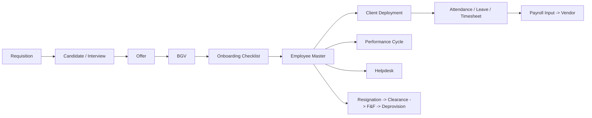

# HRMS Phase 0 – Approved Design Pack

Status: **Approved baseline** (sign-off recorded in `delivery_phase_signoffs`).

## 1. BRD – Business Requirements (summary)
| ID | Requirement | Success measure |
|----|-------------|-----------------|
| BR-01 | Single employee master with effective-dated history | 100% of changes carry user/timestamp/source |
| BR-02 | Role-based access, MFA for privileged actions, field-level protection of pay/bank/statutory data | No unauthorised read in access review |
| BR-03 | Hire-to-retire lifecycle: ATS, BGV, onboarding, deployment, exit | All stages tracked in one system |
| BR-04 | Leave, attendance, timesheet, payroll-input automation | Payroll inputs generated after cut-off with no manual re-keying |
| BR-05 | Client/project deployment and billability visibility | Allocation vs SOW visible per client |
| BR-06 | Helpdesk with SLA and escalation | SLA breach auto-escalated |
| BR-07 | DPDP-aligned privacy, retention and audit | Retention rules enforced; exports logged |
| BR-08 | Controlled AI assistance (policy Q&A, search, analytics) | Every AI interaction logged; no PII leakage |

## 2. FRD – Functional Requirements (by module)
- **Identity & Access**: roles, permissions, SSO (OIDC/SAML), MFA step-up, access reviews, deprovisioning on exit.
- **Employee Master**: person, employment, organisation, department, designation, location.
- **Documents**: upload, verify, expiry, missing-document reminders, access/download logging.
- **Onboarding**: role/client checklist templates, task tracking.
- **Leave & Attendance**: leave types/balances/requests (two-level approval), shifts, holidays, attendance, timesheets.
- **ATS & BGV**: requisitions, candidates, interviews, offers, BGV with SLA escalation.
- **Payroll Integration**: monthly inputs, vendor batch dispatch (API/SFTP/encrypted file), reconciliation.
- **Client Deployment**: clients, projects, SOWs, allocations, transitions.
- **Helpdesk**: tickets, SLA escalation.
- **Exit**: resignation, clearance, F&F input, separation deprovisioning.
- **Performance**: cycles, goals, KRA/KPI, reminders.
- **Dashboards/Reports**: role-scoped dashboards, scheduled authorised reports.
- **AI layer**: policy assistant, intelligent search, analytics, workflow assistance (human-in-the-loop).

## 3. Process Map – Hire to Retire

## 4. Data Model
41 core entities (Employee, Person, Employment, Organization … Audit Log) catalogued in the Entity Explorer (`/admin/entities`); migrations 001–022 under `Back-End/migrations`.

## 5. UX Principles
Role-based sidebar; responsive layouts (desktop/tablet/mobile); WCAG-minded contrast and skip-link; installable PWA shell; consistent card/table/tab patterns; every list filterable and exportable only through logged exports.

## 6. Architecture
React 18 + Vite SPA → REST (Node.js/Express, JWT, rate-limited, validated) → PostgreSQL 16; S3-compatible object storage (AES-256-GCM); OIDC/SAML SSO + MFA; containerised for AWS/Azure/GCP. Rationale and TCO: `/admin/tech-stack`.

## 7. Phase Roadmap
See `/admin/delivery-roadmap` for live phase status derived from the running system.
